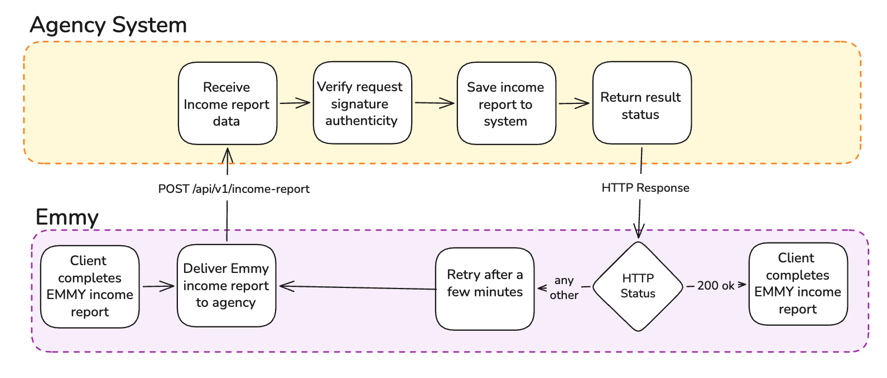

Emmy sends a completed report to your agency's receiver, which verifies the
request signature, saves the report, and returns an HTTP response.

The diagram shows the income report flow. The CE Activity Report uses your
agency's configured CE receiver URL, illustrated in this reference as
`/api/v1/income-report`, but might be better named for CE as
`/api/v1/ce-report`.
